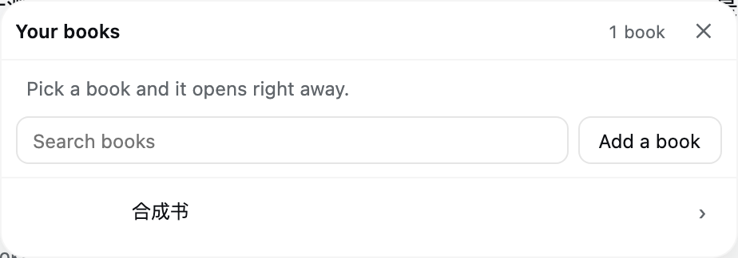
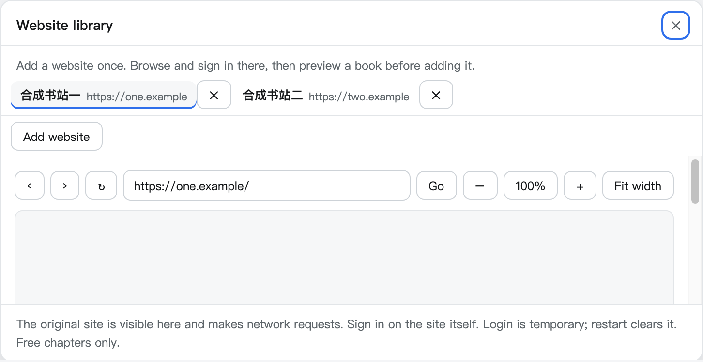

# Stealth reader

A novel reader that lives inside [DeepSeek Harness](https://github.com/deepseek-ai/deepseek-harness):
a side column, or one quiet line above the input box. It reads local files and
web novels, and **keeps novel text out of your conversations** — no title, no
path, and no chapter text ever reaches a session transcript.

English | [中文](README.zh.md)


## What it is for

Reading a novel in the same window you work in, without the reading showing up
in the record. The panel is a separate surface from the conversation: chapter
text is written to disk and drawn in the panel, never into a session. The agent
tool that manages the library reports counts and positions only.

Turn the plugin off and the panel and the tool go away. Cached chapters stay on
disk until you delete them.

## Where it appears

Open the settings (**⚙** in the toolbar) and pick one of two places. The choice
is remembered, so the reader comes back where you left it.

| Placement | What you see |
| --- | --- |
| **Side column** | The reading panel opens as a tab in the Harness sidebar on the right |
| **Line above the box** | A small, quiet mark sits just above the input box; the text appears as one or two lines above it |

The settings are read by the panel, the sidebar and the card alike, so changing
the text size once changes it everywhere.

## Books



The catalog lists every book the reader knows about: local files, and novels
added from a website. One click opens one and puts the text back in front of
you.

- **Local files** — `.txt`, `.epub`, `.docx`, `.md` and `.html`. GBK and UTF-8
  are both read.
- **A folder at a time** — add a folder and every supported file in it is
  imported at once.
- **Remembered folders** — the shelf can be scanned for files added later.
- **Websites** — a site is added once, then read from inside the app.

Nothing is uploaded. The library, the reading positions and the cache stay on
this machine.

## Websites



A site is added once by its home address. The page opens inside an isolated,
temporary browser: browse and sign in there as you normally would, then ask the
reader to identify the current book. It shows the cleaned sample it found, and
one confirmation puts the book in the library.

- Sign-in stays inside that temporary session. No password and no cookie is
  copied anywhere, and the session is cleared when the app restarts.
- Only freely readable chapters are imported.
- A site that needs a Desktop browser bridge says so; in a plain web Harness it
  shows the unavailable state instead of pretending.

## Reading

- **The wheel moves the text.** Over the card, the wheel advances a line at a
  time and crosses into the next chapter at the end of one.
- **Page by page** — the card shows as many lines as you asked for, and the page
  ends on a line, never through a word.
- **Search** — search the book and step through the places it was found.
- **Contents** — every chapter, in order, one click away.
- **Text size, line spacing, font and width** are yours to set.

## Disguise skins

The default skin names the book. The others do not: they number the documents
instead, and hide book names, chapter titles and sample text. Pick one when the
name of what you are reading is the thing that would give it away.

## Keyboard

Every chord needs **Ctrl+Alt** together. On macOS that is `Control+Option`.

| Chord | What it does |
| --- | --- |
| `Ctrl+Alt+N` | Open or hide the panel |
| `Ctrl+Alt+→` / `Ctrl+Alt+←` | Next / previous chapter |
| `Ctrl+Alt+D` | Next disguise skin |
| `Ctrl+Alt+L` | Move between the side column and the line above the box |
| `Ctrl+Alt+=` / `Ctrl+Alt+-` | Larger / smaller text |

Inside the panel:

| Key | What it does |
| --- | --- |
| `Escape` | Put the card away, or close whatever is on top of it |
| `PageDown` / `PageUp` | One page forward or back |
| `←` / `→` | One page forward or back, when the card has the focus |

A field outside the reader keeps its own keys: a chord typed into the composer
is the composer's, not the reader's.

## Install

**Inside DeepSeek Harness Desktop:** open **Plugins**, choose **Add plugin**, and
paste the package name:

```
dsh-plugin-stealth-reader
```

**For a plain `dsh web`:**

```sh
dsh plugin --profile web add dsh-plugin-stealth-reader
```

Then restart `dsh web`. For a custom profile, replace `web` with its name.

**Do not install the Desktop app's plugin from a terminal.** Desktop manages its
own profile, and a terminal install lands in a different one, so the plugin
would not appear there. Use **Plugins → Add plugin** inside the app.

**From this checkout**, if you want to work on the plugin itself: point `dsh
plugin` at the `dsh-plugin-stealth-reader` directory instead of a package name.

After the plugin is enabled, **refresh the Harness window (⌘R)**. The panel is
client-side code, so a window that was already open keeps running the version it
started with.

To remove it, disable or uninstall the bundle from **Plugins**. Cached chapters
stay on disk; delete the profile's reader directory to remove them too.

## Verifying it

Everything here runs offline against synthetic books — no real library, no
network, and no novel text in any output.

| Suite | What it covers |
| --- | --- |
| `stealth-reader-selftest.mjs` | Host behaviour, formats, the reader service |
| `stealth-reader-webtest.mjs` | Reading and parsing web pages |
| `stealth-reader-routetest.mjs` | The local route, permissions, and **the privacy promise** |
| `stealth-reader-storetest.mjs` | Storage, cache, and credential rules |
| `stealth-reader-crashprobe.mjs` | Every reader component, focus order, timers |
| `stealth-reader-browsertest.mjs` | The isolated site browser |
| `verify/dom/run-dom-test.mjs` | The shipped client bundle in a real Chrome |

```sh
node stealth-reader-selftest.mjs
node verify/dom/run-dom-test.mjs --shot=/tmp/card.png
bash deploy-gate.sh
```

`run-dom-test.mjs` needs a local Chrome. Pass `--shot=<path>` for a picture,
`--dark` for the dark theme, `--zh` for Chinese, `--empty` for a fresh install,
and `--sites` for the book page. The four images in this README were produced
exactly that way, from synthetic chapters.

`deploy-gate.sh` runs what a release insists on: parsing, locale parity, the
inlined browser helper, the host packages the client binds to, the packed
tarball, and the two privacy suites. **A build that could put chapter text into
a tool result is refused.**

## Layout

```
dsh-plugin-stealth-reader/   the bundle: host half, client half, locales, icon
  lib/index.js               host: library, cache, route, agent tool
  lib/client.js              client: every surface, one static file
  lib/reader-browser.js      the isolated site browser (inlined into client.js)
verify/                      the checks, and the fixture data they compare against
docs/images/                 the pictures in this README
*.mjs                        the suites, runnable on their own
deploy-gate.sh               the release gate
```

## Notes

- Test data is synthetic. The suites write their own chapters into a temporary
  directory and delete them afterwards.
- Nothing in this repository is a real book. A sample folder is ignored on
  purpose, so a public repository cannot carry one by accident.
- The window must be refreshed after the plugin changes.

## Licence

MIT.
