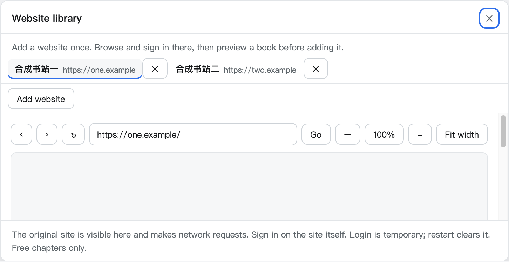
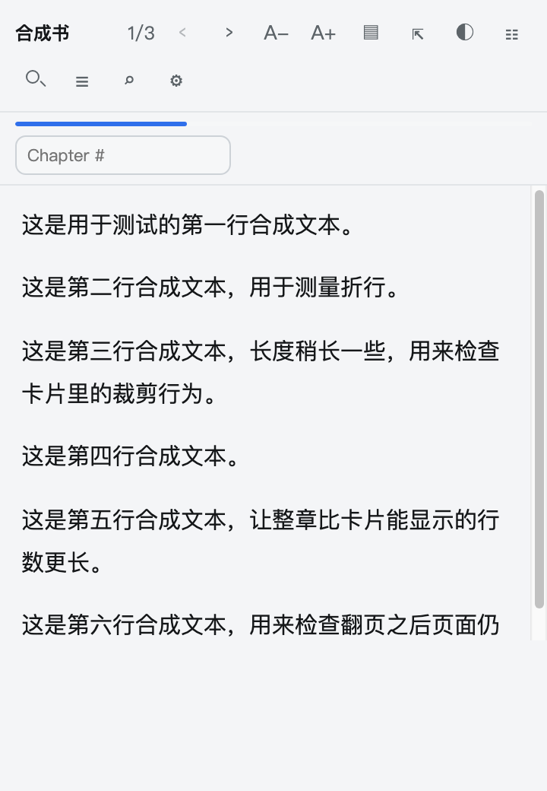
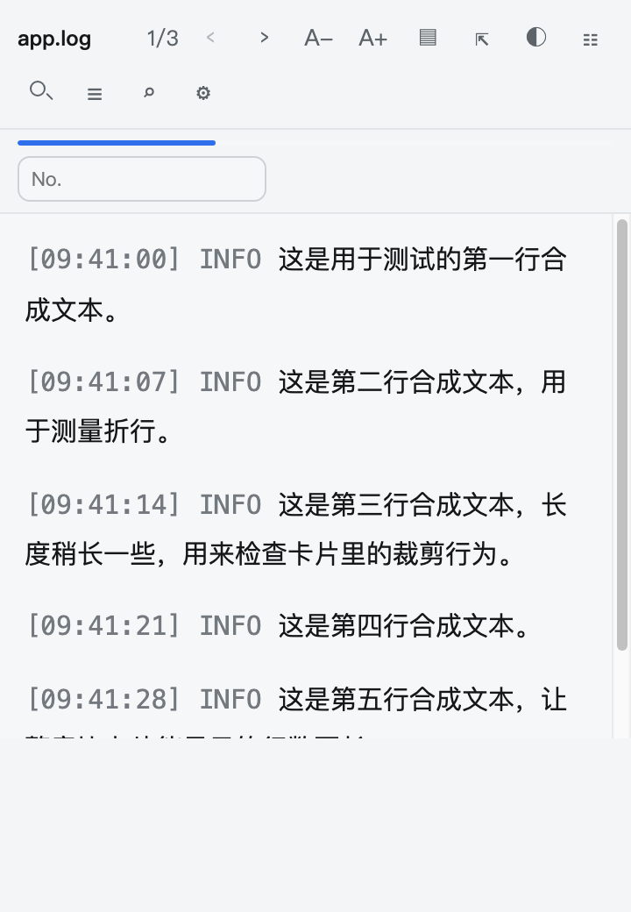
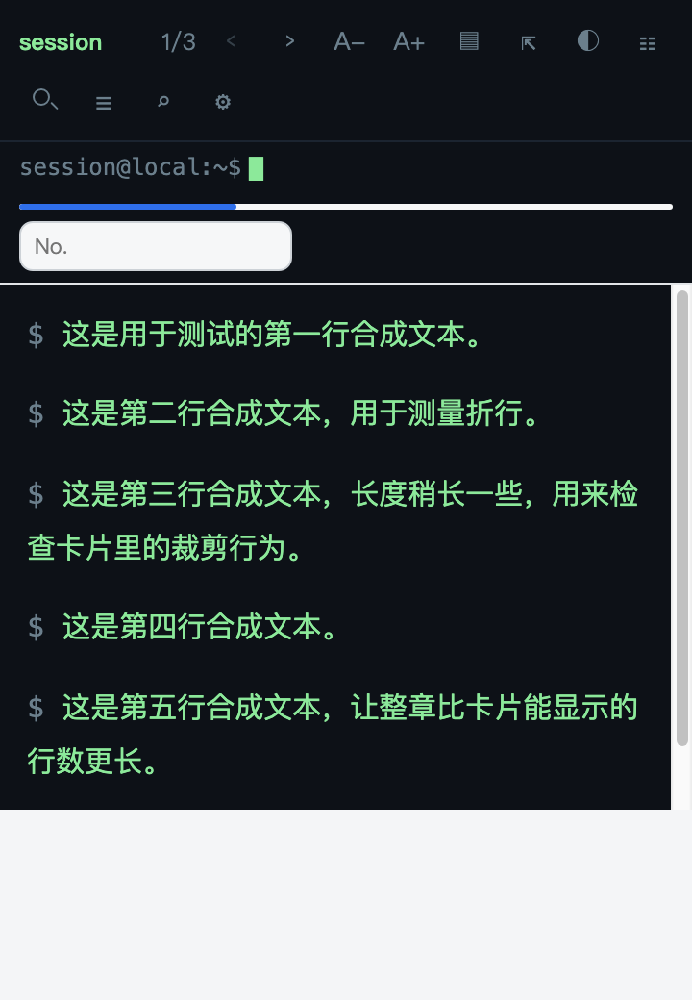
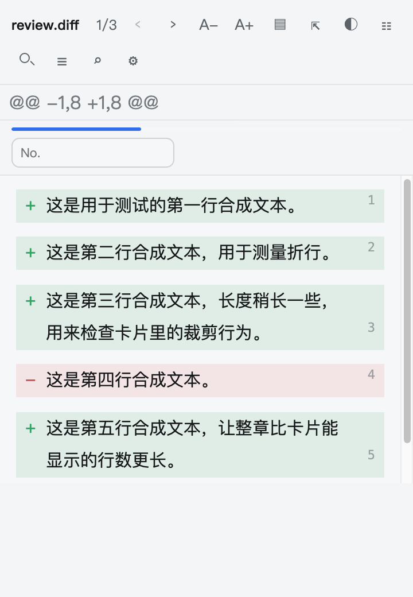

# 隐蔽阅读器

一个住在 [DeepSeek Harness](https://github.com/deepseek-ai/deepseek-harness) 里的
小说阅读器：右侧一栏，或者输入框上方一行不起眼的文字。它读本地文件和网络小说，
并且**不让小说内容进入你的对话**——书名、路径、正文，都不会出现在会话记录里。

[English](README.md) | 中文


*卡片在桌面版里、输入框上方的真实样子。图中章节正文和书名已遮罩：这张图要展示的是
阅读器本身的形状——文字区、进度细线、百分比，以及那一排控件。*

折叠起来，卡片就是输入区里一行安静的横条。这一张用的是封面故事：它读起来像一条同步
摘要，不像一本书。


## 它是做什么的

在同一个窗口里看小说，而看小说这件事不留下痕迹。面板是与对话分开的表面：章节
正文写到磁盘上、画在面板里，永远不进会话。管理书库的那个 agent 工具只报告数量
和位置。

关掉插件，面板和工具一起消失。已缓存的章节留在磁盘上，直到你自己删掉。

## 它出现在哪

打开设置（工具栏的 **⚙**），二选一。选择会被记住，下次回来还在原处。

| 位置 | 你看到的 |
| --- | --- |
| **侧栏** | 阅读面板作为右侧栏的一个标签页打开 |
| **输入框上方** | 输入框上方有一个很小、很淡的记号，正文以一两行的形式出现在它上面 |

面板、侧栏和卡片读的是同一份设置，所以字号改一次，处处都改。

## 书


书库列出阅读器知道的每一本书：本地文件，以及从网站加进来的小说。点一下就打开，
正文回到眼前。

- **本地文件**——`.txt`、`.epub`、`.docx`、`.md`、`.html`。GBK 和 UTF-8 都能读。
- **整目录导入**——选一个目录，里面每个支持的文件一次全部导入。
- **记住的目录**——可以重新扫描，把后来新增的文件加进来。
- **网站**——添加一次，之后在应用内阅读。

什么都不上传。书库、阅读位置和缓存都留在这台机器上。

## 网站



一个网站只需添加一次它的首页地址。页面在一个隔离的临时浏览器里打开：像平常一样
浏览和登录，然后让阅读器识别当前这本书。它会把找到的干净样章给你看，确认一次，
书就进了书库。

- 登录态只留在那个临时会话里。密码和 Cookie 不会被复制到任何地方，应用重启后
  会话清空。
- 只导入免费可读的章节。
- 需要桌面端浏览器桥接的网站会明说；在纯 Web 的 Harness 里显示为不可用，而不是
  假装能读。

## 阅读

- **滚轮就是翻页。** 在卡片上滚动，一次走一行，滚到章末自动进下一章。
- **整页翻**——卡片显示你指定的行数，页面结束在一整行上，绝不切断一个字。
- **搜索**——在整本书里搜，按顺序走过每一个找到的位置。
- **目录**——每一章按顺序列好，一点就到。
- **字号、行距、字体、宽度**都由你定。

## 伪装皮肤

`plain` 皮肤显示书名，正文就是正文：



其他三个不显示书名。它们把文档编号，并且把每一行装扮成别的东西：

| 皮肤 | 面板看起来是 | 每一行看起来是 |
| --- | --- | --- |
| `plain` | 书名本身 | 正文 |
| `log`（默认） | `app.log` | 日志：时间戳 + `INFO`/`WARN`/`ERROR` |
| `terminal` | `session` | 终端：提示符、绿字、深色底 |
| `diff` | `review.diff` | 代码审查：`+`/`-`、行号、hunk 头 |







伪装藏起来的是：书名、章节标题、任何样章文字。它保留的是：你读到全书的哪个位置，
以及阅读界面的形状——所以扫一眼屏幕，看到的是工作，不是小说。

当「你在读什么」本身就是需要藏起来的东西时，选一个。

## 键盘

所有组合键都要 **Ctrl+Alt** 一起按。macOS 上是 `Control+Option`。

| 组合键 | 作用 |
| --- | --- |
| `Ctrl+Alt+N` | 打开或收起面板 |
| `Ctrl+Alt+→` / `Ctrl+Alt+←` | 下一章 / 上一章 |
| `Ctrl+Alt+D` | 切换下一个伪装皮肤 |
| `Ctrl+Alt+L` | 在「侧栏」和「输入框上方」之间移动 |
| `Ctrl+Alt+=` / `Ctrl+Alt+-` | 放大 / 缩小字号 |

面板内部：

| 按键 | 作用 |
| --- | --- |
| `Escape` | 收起卡片，或关掉压在它上面的那一层 |
| `PageDown` / `PageUp` | 向后 / 向前翻一页 |
| `←` / `→` | 向后 / 向前翻一页（卡片持有焦点时） |

阅读器之外的输入框保留自己的按键：在输入框里按组合键，那是输入框的，不是阅读器
的。

## 安装

**在 DeepSeek Harness 桌面版里：**打开 **插件**，选 **添加插件**，粘贴包名：

```
dsh-plugin-stealth-reader
```

**在用 `dsh web` 时：**

```sh
dsh plugin --profile web add dsh-plugin-stealth-reader
```

然后重启 `dsh web`。如果是自定义 profile，把 `web` 换成它的名字。

**不要用命令行给桌面版装插件。** 桌面版管理自己的 profile，命令行装进去的是另一个，
插件不会出现在桌面版里。请用应用内的 **插件 → 添加插件**。

**从这个仓库本地安装**（想改插件本身时）：把 `dsh plugin` 的目标从包名换成
`dsh-plugin-stealth-reader` 目录的绝对路径。

插件启用之后，**刷新 Harness 窗口（⌘R）**。面板是客户端代码，已经开着的窗口会继续
跑它启动时的那一份。

要卸载，在 **插件** 页禁用或移除这个 bundle。已缓存的章节留在磁盘上；想一并删掉，
删除 profile 下的阅读器目录即可。

## 自己验证

这里的检查全部离线对着合成的书运行——不碰真实书库，不联网，任何输出里都没有
小说正文。

| 测试 | 覆盖什么 |
| --- | --- |
| `stealth-reader-selftest.mjs` | 宿主行为、文件格式、阅读服务 |
| `stealth-reader-webtest.mjs` | 网页读取与解析 |
| `stealth-reader-routetest.mjs` | 本地路由、权限，以及**隐私承诺** |
| `stealth-reader-storetest.mjs` | 存储、缓存与凭据规则 |
| `stealth-reader-crashprobe.mjs` | 每一个阅读器组件、焦点顺序、计时器 |
| `stealth-reader-browsertest.mjs` | 隔离的站点浏览器 |
| `verify/dom/run-dom-test.mjs` | 真实 Chrome 里加载**正在发布的**客户端 bundle |

```sh
node stealth-reader-selftest.mjs
node verify/dom/run-dom-test.mjs --shot=/tmp/card.png
bash deploy-gate.sh
```

`run-dom-test.mjs` 需要本机装有 Chrome。`--shot=<路径>` 拍一张图，`--dark` 走深色
主题，`--zh` 走中文，`--empty` 模拟新装，`--sites` 打开找书页。本 README 里的四张
图就是这样、用合成章节拍出来的。

`deploy-gate.sh` 跑的是发布时必须成立的东西：语法解析、中英语言键对齐、内联的站点
浏览器与源文件一致、客户端依赖的宿主包都在、打包产物的内容，以及那两套隐私检查。
**一个可能把章节正文放进工具返回值的构建，会被直接拒绝部署。**

## 目录结构

```
dsh-plugin-stealth-reader/   bundle：宿主半边、客户端半边、语言包、图标
  lib/index.js               宿主：书库、缓存、路由、agent 工具
  lib/client.js              客户端：所有界面，一个静态文件
  lib/reader-browser.js      隔离的站点浏览器（内联进 client.js）
verify/                      各项检查，以及它们比对的夹具数据
docs/images/                 本 README 里的配图
*.mjs                        各套测试，可以单独跑
deploy-gate.sh               发布关卡
```

## 说明

- 测试数据是合成的。各套测试自己把章节写进临时目录，跑完就删。
- 这个仓库里没有任何一本真实的书。示例目录被刻意忽略，公开仓库不该因为一次疏忽
  就带上书。
- 插件改动之后必须刷新窗口。

## 许可

MIT。
