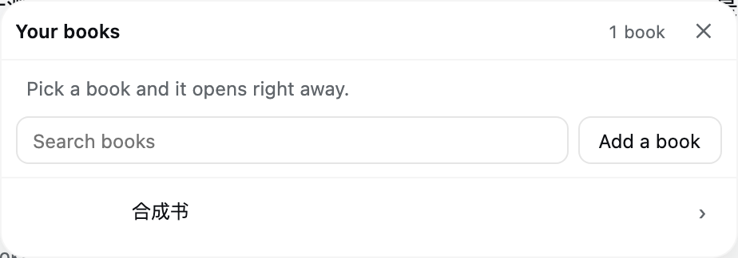
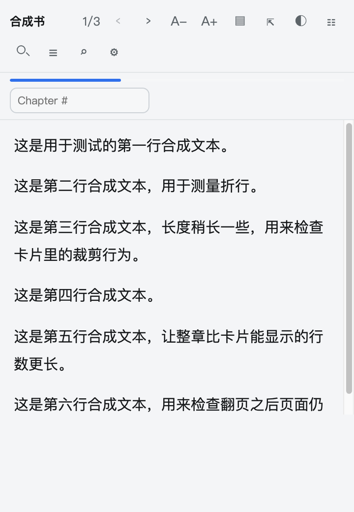
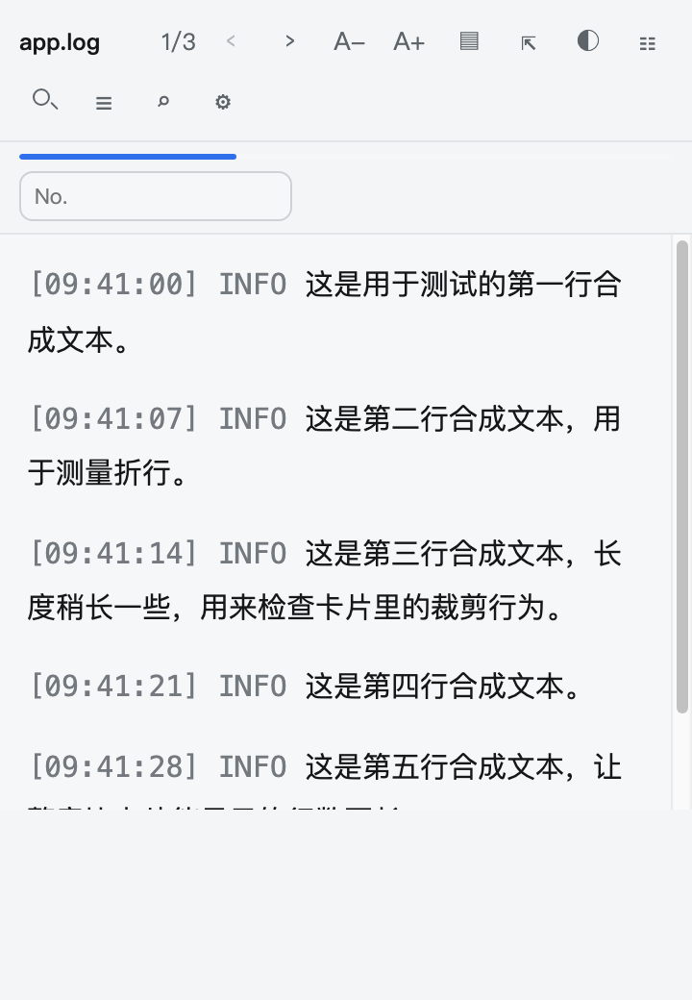
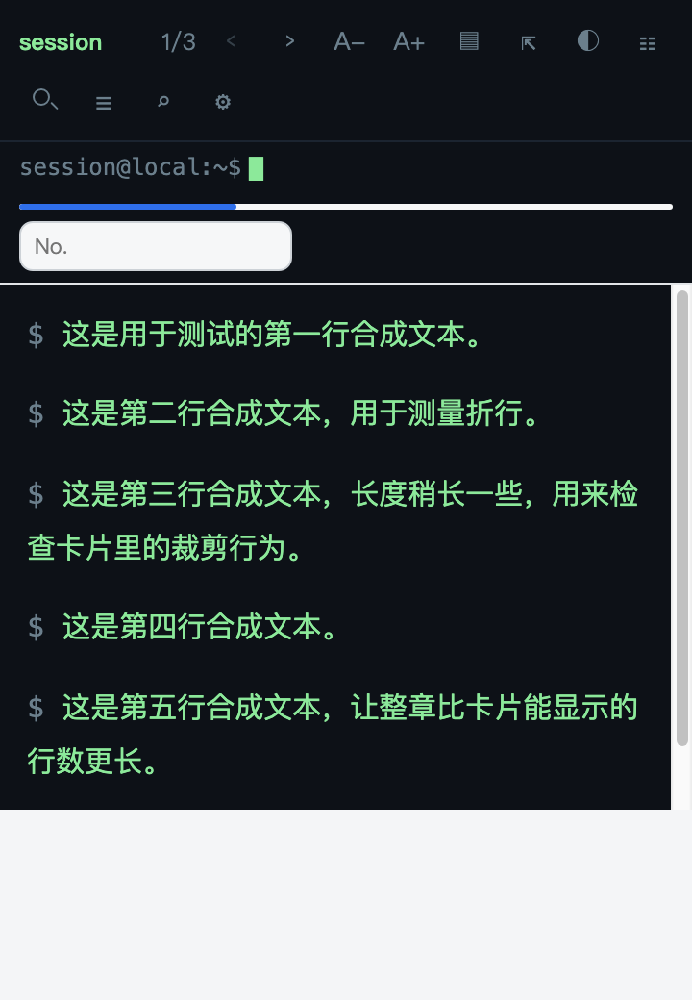
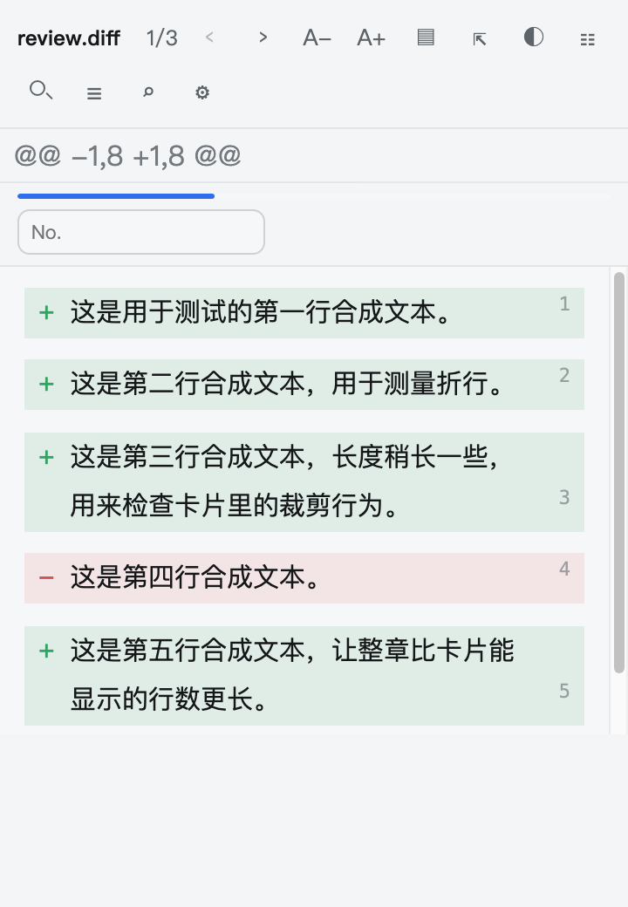
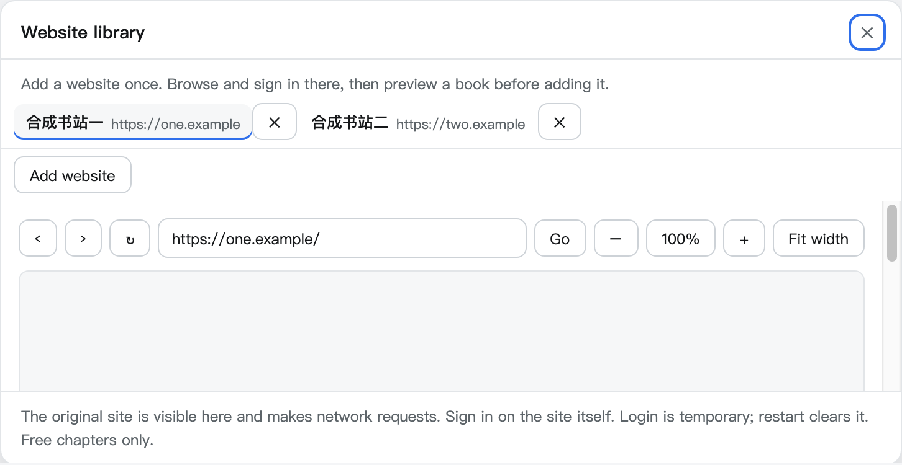

# Stealth reader

An in-window novel reader for the DeepSeek Harness. It reads local files and
web novels, and keeps novel text out of your conversations. Where it lives is
your choice: a column on the right, or a quiet line above the input box.

English | [中文](README.zh.md)

The card as it sits above the input box in the Desktop app. The chapter text and
the book's name are masked in this picture: it shows the reader's own shape, not
what was being read.


Folded, the same card is one quiet line in the composer stack. This one is using
a cover story: it reads as a sync summary, not as a book.


Unmasked, with synthetic text, in both themes:




## Install

Pick the way that matches how your Harness runs.

**From the Plugins page (DeepSeek Harness Desktop).** Open **Plugins**, choose
**Add plugin**, and paste the package name:

```
dsh-plugin-stealth-reader
```

**From a terminal, for a plain `dsh web`.**

```sh
dsh plugin --profile web add dsh-plugin-stealth-reader
```

Then restart `dsh web`. For a custom profile, replace `web` with its name.
**Do not use this for the Desktop app**: Desktop manages its own profile, and a
terminal install lands in a different one, so the plugin would not appear there.
Use **Plugins → Add plugin** inside the app instead.

**From a local checkout**, if you want to work on the plugin itself:

```sh
dsh plugin --profile web add /absolute/path/to/dsh-plugin-stealth-reader
```

After the plugin is enabled, **refresh the Harness window (⌘R)**. The panel is
client-side code, so a window that was already open keeps running the version
it started with.

To remove it, disable or uninstall the bundle from the **Plugins** page. The
cached chapters stay on disk; delete the profile's reader directory if you want
them gone.

## Verify it yourself

The checks in this repository run against the plugin as it ships, with
synthetic books only — no real library and no network.

```sh
node stealth-reader-selftest.mjs      # host behaviour
node stealth-reader-webtest.mjs       # web-page reading and parsing
node stealth-reader-routetest.mjs     # the local route, and the privacy promise
node stealth-reader-storetest.mjs     # storage, cache and credential rules
node stealth-reader-crashprobe.mjs    # the reader's components
node stealth-reader-browsertest.mjs   # the isolated site browser
node verify/dom/run-dom-test.mjs      # the shipped client in a real Chrome
bash deploy-gate.sh                   # everything the release insists on
```

`run-dom-test.mjs` needs a local Chrome; pass `--shot=<path>` for a picture of
the card, `--dark` for the dark theme, `--zh` for Chinese, `--empty` for a
fresh install, and `--sites` for the book page.

## After an update

The panel is client-side code, so the Harness window has to load the new
version of it. Refresh the Harness window (⌘R) after the plugin is enabled or
updated, otherwise the panel keeps running the code it started with.

## Where it appears

Open the settings (**⚙** in the toolbar) and pick one of two places. The
choice is remembered, so the reader comes back where you left it.

| Placement | What you see |
| --- | --- |
| **Side column** | The reading panel opens as a tab in the Harness sidebar on the right |
| **Line above the box** | A small, quiet mark sits just above the input box; the text appears as one or two lines above it |

### Side column

The reader is a tab in the right-hand sidebar, next to the terminal and the
other Harness panels. Press **Ctrl+Alt+N** to open the tab; the sidebar's own
close button puts it away. The panel fills the tab, so it has no frame of its
own and no close button — the sidebar owns that. Opening another tab does not
close the reader: it stays in the sidebar until you close it or move it back to
the card.

### Line above the box

A small mark sits just above the input box, between it and the DeepSeek brand.
It is deliberately low-contrast and small, so it does not draw the eye.

* Pointing at it (or tabbing to it) opens one or two lines of the text above
  the input box.
* **The wheel moves the text.** Over the strip, the wheel advances a line at a
  time and crosses into the next chapter at the end of one; at the very start
  or the very end of the book the wheel is left alone, so the conversation can
  be scrolled as usual.
* **A page turn is measured once, not once per render.** The page ends where its
  last drawn line ends, which is found by measuring rendered text — and every
  measurement forces the browser to lay the page out again. The answer is
  remembered for as long as the text, the place, the line count and the
  typography stay the same, because the card re-renders several times per turn
  and eleven forced layouts per render is felt as a stutter on the wheel.
* **Notches are folded, not dropped.** A turn is scheduled once per animation
  frame and the notches that arrive inside that frame are added together, so a
  trackpad flick moves smoothly instead of being cut into dropped steps.

* **The wheel never reaches the conversation.** The card takes the wheel while
  it has text to show, and the lists take it while they can still be
  scrolled, so the page behind never scrolls away under a surface that is
  open. The card listens for the wheel on its own, and the listener is not
  passive: React listens for the wheel at its own root and does so passively,
  which is why the conversation used to scroll away under the card while it
  was being read.
* The `⇲` button moves the reader to the side column, which is the full
  reading view.
* **Esc** puts the strip away again and gives the focus back to the mark.

The strip never takes part in the layout of the input box, so the composer
never moves while you read.

## What you see

The reading panel renders the current chapter, tracks your position per book,
and remembers your last skin, font size, line spacing, font, width and
placement.

The panel is a separate surface from the conversation. Chapter text is never
written into a session, so a chat transcript, a session title and the sidebar
stay free of novel content.

## Settings

**⚙** in the toolbar opens one centred page with four tabs, so a preference is
never buried under three subjects you were not looking for. Every choice is
written as soon as you make it, so you never have to set the same thing twice.

| Tab | What it holds |
| --- | --- |
| Reading | Placement, text size, line spacing, typeface, reading mode, how many lines the card shows |
| Looks | The disguise skin and the panel width |
| Books | Your books in either shape, and the three ways to add one |
| Websites | The sites you saved, and the way into the website library |

`←` and `→` move between tabs. **☰** opens the page on Books, because adding a
book is what that button is for; **⚙** opens it on Reading. Both close the page
when it is already open. Escape closes the page and stops there: it does not
also close the reader underneath.

The repair selectors for a site the automatic reader could not handle live
under **Advanced** in the Books tab, closed until asked for. **Restore
defaults** sits in the footer, which stays put while the body scrolls.

The Books tab draws the library in two shapes, switched by the button at the
right of the list's first line and remembered like any other preference:

* **List** — one row per book, with its chapter count.
* **Covers** — a shelf of book shapes. Each shape is drawn from the theme's own
  surface and border tokens, so it reads as part of the settings page in both
  the light and the dark theme, with no colour of its own. An EPUB that
  declares a cover shows that image over the shape; the name stays drawn
  underneath, so a cover that fails to load still leaves the book named.
  One line under each shape says where the book lives: **Local** for a file on
  this machine, **Web** for a page read from a website, with the saved chapter
  count (for example `42/300`) when part of it is already on disk. A website
  book also gets one small accent dot on the shape.
  A disguise skin numbers the books, drops the line and the dot, so a shelf
  left open names neither a book nor its origin.
  A title that carries `作者：…` from its file name is split: the name is the
  shape's title and the author is a quieter line under it.

A cover is stored as one small image file beside the library and is fetched
only for the books that report one, so a shelf of plain text files costs no
requests. The image is served over the same authenticated route as the text,
and its stored file name is checked before it is read.

## Reading features

| Feature | How |
| --- | --- |
| Progress | The bar above the text shows how far into the book you are |
| Table of contents | The `☷` button lists every chapter; click one to jump |
| Chapter jump | Type a number in the chapter box and press Enter |
| Search | The magnifier button opens a search page. Type a word and press Enter: **every place** the word was found in the whole book is listed, each with the chapter, the line and the text around it. Click a place to land on that exact line. The `‹` / `›` buttons in the text step through the matches of the chapter on screen |
| Scroll memory | Returning to a chapter lands on the same line |
| Text size | The `A-` / `A+` buttons, or the slider in the settings |
| Line spacing | The settings page |
| Font | Sans, serif or monospace, from the settings page |
| Panel width | The slider in the settings page |
| Reading mode | The `▤` / `⇊` button, or the settings page |

### Reading modes

There are two ways to read.

**One chapter** (`▤`) shows a single chapter. `Ctrl+Alt+→` and `Ctrl+Alt+←`
replace the text with the next or the previous chapter.

**Continuous** (`⤓`) joins the chapters into one long column. The next
chapter is fetched as the reader reaches the end of the text, and the
previous one when the reader goes back up, so the text never ends under the
eye. `Ctrl+Alt+→` and `Ctrl+Alt+←` move to the neighbouring chapter *inside*
the column: the text around them stays where it was. Picking a chapter from
the table of contents starts the continuous text over at that chapter.

The continuous mode keeps sixteen chapters loaded and drops the oldest one as
it goes, so a long session does not grow the page. The reading position is
remembered per book in both modes.

While the next chapter is on its way, the column says so at its end, and the
end of the book is marked too. A chapter that could not be loaded is not asked
for again on every scroll; a step forward asks for it once more.

### The card above the input

The card is **open by default**, the way the Todo and Goal cards are. Its
**⌃** button folds it away. A quiet entry in the native composer right toolbar
opens it again on click, without occupying a dock row or overlapping its border. All of this is a preference under **Settings → Reading**:

| Setting | Values |
| --- | --- |
| Can fold | yes (default), or no to keep the card always |
| Folded shape | native toolbar entry (default), or a one-line bar |
| Folding | only when I fold it (default), when the pointer leaves, never |
| Lines per page | 1–8; the page ends exactly where its last drawn line ends |
| Fold delay | 80–800 ms, shown only for the "pointer leaves" mode |

**Text size and line spacing apply to both shapes.** The card reads the same two
numbers the side column reads, so choosing 18 px makes the card bigger as well;
the card caps itself at 18 px, because it sits above the input box and a 26 px
body would make it taller than the box it belongs to.

The **typeface** is different: it is part of the disguise. The log, terminal and
diff skins are monospaced on purpose, so a chosen typeface reaches only the
plain skin, and the settings page says so rather than offering a control that
cannot work.

The **one-line bar** is built the way the Goal card is: 36 px tall, on the
composer's own menu surface. Its middle text is its own setting — the same first
line as the card, just the chapter position, or a **custom line** for a
disguise (four ready-made cover stories are offered, or the reader can type
their own) — and the book's progress is an option: **percent only** (the
default), a **progress line**, both, or nothing. The percent alone keeps the row
short, so the bar reads as one line of text rather than a chart. Two transparent
controls sit inside the bar: one turns it back into
the card, the other closes the reader and removes the card from the composer entirely.
**Settings → Reading → Open the reader** explicitly restores the composer card,
even when the previous placement was the sidebar, without opening a separate
reading panel. The sidebar toolbar's return-to-card control and closing the sidebar
tab also restore a previously closed card. Explicit placement choices clear the
closed flag, including selecting the current placement again. Switching back to the
card hides the retained sidebar reader immediately and closes its own visible tab
through the slot's `useTabInfo().tab.actions.close()`; unrelated sidebar tabs stay open.
Tab visibility changes and React body unmounts do not close the reader or change
placement. Only an explicit return-to-card command closes the reading tab; actual
record closure is tracked through its AbortSignal, with current-occurrence ownership.
Manual opening/re-navigation restores the sidebar reader, including an existing tab.
Stale settings hydration cannot override a surface explicitly chosen this session.
The native toolbar owns entry placement; former floating-mark positioning
preferences are retained only for compatibility and are no longer offered.

Nothing about the card's shape is fixed. "Can fold" is separate from "Folding":
turning it off removes the fold button and keeps the full card, while a fold
mode of "never" still lets the reader fold the card by hand.

Its first line is one of three presets, chosen under **Settings → Reading →
First line**: the book's name, the reading progress, or a neutral line that
numbers the document without naming it. Progress is a number, so it stays
visible even in a disguise skin.

A page is a number of **rendered lines**, not a number of characters: the text
is measured, and the page ends where its last drawn line ends, so the next page
starts with the very next word and no text is skipped or repeated.

The card is the text and **one row**: back, forward, the book's place, the
book's progress as a hairline with its percentage, search, the table of
contents, open the catalog, find books, move to the side column, and the fold
control. There is no title row and no progress row of its own: both used to
cost a line of reading height, so what they carried now shares the footer.
The old "open the floating panel" button is gone: that panel is no longer a
shape, so the button opened nothing. The side column (the `⇲` button) is the
full reading view.

The **table of contents** (`☷`) and the **catalog** (`☰`) are two doors: the
first lists the chapters of the book being read, the second the books in the
library. Picking a chapter opens it at the top.

The card's own magnifier button opens a small search field in the footer's own
space, so the card keeps its height. The search covers the whole book, and
**every place the word was found is listed** — the chapter, the line and the
text around it — so the reader picks the one that was meant; the card goes
there.

The list is drawn **over the window**, just above the card, because the
composer cuts off anything that grows out of it. `Escape` or a click
anywhere else closes it. The search field itself closes as soon as the search
has worked, so the row looks exactly as it did before: no bar and no count
left over.

The list of the chapters opens the same way, over the same card.

A search made in the side column lands on the same place in the card, because
the two surfaces count the text differently and each one keeps its own place.

### A value the card pages with lives above the shape it draws

The card is one component with two shapes, and it renders even when the reader
is in the side column or has closed the reader: on those renders it draws
nothing, and every value and callback it keeps is still rebuilt. A value
declared *below* that early return is never initialised on such a render, and
a callback rebuilt on it closes over a hole — the first wheel after coming
back threw `Cannot access 'visibleLines' before initialization`, and neither
the wheel nor the arrow keys turned a page again.

So anything the paging call needs — how many lines a page holds — is declared
above the early return, next to the other state, and a test asserts it stays
there.

### A place belongs to its chapter

The card counts the text in characters and the side column counts it in lines,
so each one keeps its own place and the other one keeps the place it had.

**A place belongs to the chapter it was measured in.** When the reader turns
to another chapter, the place that was measured in the chapter before is not
a place in the new one: the number would point at a sentence that was never
there. So a chapter that has just been entered starts its place at the top,
in both surfaces, and a reader who reads in the side column and comes back to
the card finds the top of the chapter they are in — not the middle of a
sentence, and a card that cannot turn a page because its place is past the
end of the text.

### One way of being a list

Every list in the reader is built the same way, so the reader learns it once
and never has to work out a new shape:

- a **head**: the name of the list, how many things it holds, and the ✕ that
  closes it;
- a **body**: the rows, scrollable, with the same padding everywhere;
- a **row**: the small facts on the left (the chapter, the line, the author,
  the number of chapters) and the text on the right — the text of a place
  wraps, the name of a chapter does not;
- the same **keyboard**: `Escape` closes the topmost list and nothing else.

The lists that follow this shape are the table of contents, the places a
search found, the books of the library, the chapters of a book inside the
library, and the books of the website shelf.

### One way of arriving

Every popup opens **in the same place and at the same width**: one top edge, one
left edge, one width, one radius, one shadow, one border.

| Surface | Size | Why |
| --- | --- | --- |
| Catalog, settings page | 720 wide, 420-640 tall | a list of rows; it sizes to its rows between a floor and a ceiling |
| Website shelf | 720 wide, 640 tall | it carries a browser, so it takes the full height |
| List over the card | 320 wide | it sits beside the text, so it stays a strip |

They hang from a shared top line rather than being centred, because the edge the
eye reads is the top one: a list of three books used to open 110 px lower than
the shelf, which is what "they open in different places" describes. A frame that
grows downward from one line always starts where the last one did.

Widths used to be 260 / 430 / 520 / 1080 with two radii and three shadows, which
reads as four unrelated things rather than one reader.

A popup **arrives** rather than appearing, and the frame itself does not move:
it fades in where it will sit, and its head settles 3 px into place a beat
later. An earlier version lifted and scaled the whole box, which read as a
wobble. A docked surface (the sidebar variants) fills the pane it was given, so
it only becomes readable; and the shelf, which stays mounted while hidden,
carries its arrival on a class so it does not spend the animation before anyone
sees it. `prefers-reduced-motion` turns all of it off.

### One way out of a surface

The ✕ is one way out of a surface, and it is not the only one. **A click on
the empty area around a surface closes it**, and every surface of the reader
is closed that way: the table of contents, the places a search found, the
catalog of the books, the website shelf and the settings page. The reader
learns it once, and a click outside never leaves a surface hanging over the
page.

### Finding a place inside a book

The **magnifier** button in the panel's toolbar opens a page of its own: a
field, the count of the matches, and the list of every place the word was
found. The search covers **the whole book**, not only the chapter on screen,
and **every** occurrence is found, not only the first one of a chapter.

Each row names where the word was found — the chapter on the left, the line
under it — and shows the **whole line** the word sits on, so a reader can
recognise the place before choosing it. A few words are not enough to tell
one place from another, so the line is given in full; a line longer than a
screen is cut around the word.

Clicking a row puts the reader on that line and closes the page. The word stays
marked in the text, and the `‹` / `›` buttons walk through the other matches of
that chapter.

A word that appears very often is found in full, but the list holds the first
thousand places: the count above the list says how many there are, and a note
says when the list is shorter than the count.

### Picking a book

The **catalog** (`☰`) is a page of its own, beside the text rather than inside
the settings. It lists every book, has a search field, and one click opens a
book — the text comes back immediately, in the shape the reader was using.

Each book has its **chapters** one click away (`▾` beside the name): the list
of chapter titles, and a click on one opens the book at that chapter. A reader
who knows which chapter they want does not have to open the book and hunt for
it.

The catalog is open from the panel's `☰` button, from the card's `☰` button,
from **Settings → Books**, and the **Find books** page carries the same
directory above its website browser, so the books that are already there are
always one click away.

### Where the reader lives

There are two shapes, and the settings pick which one opens.

**The card** (`strip`) sits in the stack above the input box, next to the
queue and the goal cards. It is one quiet line: the document, the section,
and a chevron. Hovering opens it into one or two lines of the text; the wheel
moves the text a line at a time, the `‹` / `›` buttons do the same, and the
arrow keys work while the card has the focus. A page up or down moves five
lines. The card follows the reader: a chapter turned in the panel shows up
here at once.

**The side column** (`sidebar`) is the Harness's own right panel. It carries
the whole reader: the toolbar, the progress bar, the table of contents and the
search. It needs a session, so it is not there on an empty home screen.

Picking a document from the card opens the reader in the side column. If the
side column cannot take it, the card stays and the reader opens from there.

Under a disguise the card numbers its documents ("Document 3 · Section 12").
The plain skin names them, because that is what the plain skin is for.

## Shortcuts

| Shortcut | Action |
| --- | --- |
| `Ctrl+Alt+N` | Show or hide the panel |
| `Ctrl+Alt+→` | Next chapter |
| `Ctrl+Alt+←` | Previous chapter |
| `Ctrl+Alt+D` | Cycle the disguise skin |
| `Ctrl+Alt+=` / `Ctrl+Alt+-` | Larger / smaller text |

On the desktop the chords are reserved through the Harness shortcut service, so
they appear in the shortcut list and cannot collide with another command. Every
chord but `Ctrl+Alt+N` acts on the panel, so it only runs while the panel is
open: a hidden panel never advances the document behind your back.

On macOS these are `Control+Option` (`⌃⌥`), not `Command`. The macOS system
shortcuts are `Command`-based, so they are left alone. `Control+Left` and
`Command+Left` switch spaces on macOS; the extra `Option` keeps the arrow
chords clear of them.

A chord is ignored while a text field outside the panel has the focus, so
typing in the chat box or in a setting is never interrupted. Inside the panel
the chords keep working, so the arrow keys still turn the page while the find
box has the focus.

On macOS `Option+N` is a dead key, and the Harness shortcut service reads a
dead key as an input method composition and drops the gesture. The panel
listens for that case itself, so `Ctrl+Alt+N` works on macOS as well.

## Supported formats

| Format | Extension | Notes |
| --- | --- | --- |
| Plain text | `.txt` | The usual format for Chinese web novels |
| EPUB | `.epub` | The title and the spine order come from the book |
| Word | `.docx` | Split at the Heading 1 paragraphs |
| Markdown | `.md` | Split at the level-one headings |
| HTML | `.html`, `.htm` | The text-heaviest block is used |

MOBI, AZW, AZW3, PDF, CHM, FB2 and DjVu are recognised but not opened; the
panel names the format and asks you to convert it to TXT or EPUB.

### Chapter detection

For plain text the plugin recognises:

* `第十二章`, `第 3 回`, `第十九卷` and the other `第…` forms
* `Chapter 3`, `Chapter One`
* `序章`, `楔子`, `尾声`, `番外`, `终章`, `附录`
* `01.吉隆坡之夜`, `12、回归`, `7 夜行`

A file without a recognisable heading is shown as one long chapter.

### Encoding

Documents are read as UTF-8, and a file that is not valid UTF-8 is decoded as
GB18030/GBK instead. Chinese novels distributed as GBK are common, and reading
them as UTF-8 would otherwise turn the whole book into unreadable text and
collapse every chapter into one.

## Reading position

The panel and the host keep one position per book, and they agree: a jump
through the table of contents, a step with `Ctrl+Alt+→` and a step with the
`‹` / `›` buttons all continue from the chapter on screen. The host holds the
position too, so the `doc_panel` tool moves the same book the panel is on.

The place is more than a chapter number: it is the chapter, the line inside it
and the surface it was read on. The line is what the wheel moves, so the
strip and the panel always name the same place — open the full panel after
reading in the strip and you land on the line you left.

The two surfaces count the text differently, and each one now keeps its own
place: the panel counts the lines that carry text, and the card counts the
characters of the flow it draws. A search result names both, so the reader
lands on the same sentence whichever surface it is read on.

## Disguise skins

The plain skin names the book; the others do not. They number the documents and
dress the lines as something else — a log, a shell, a code review.









| Skin | Look |
| --- | --- |
| Log | Grey monospace paragraphs with `[time] INFO` prefixes |
| Terminal | Black background, green monospace text |
| Diff | Monospace lines marked `+` / `-`, like a code review |
| Reader | A plain reading surface |

In the Log, Terminal and Diff skins the header shows a neutral file name
(`app.log`, `session`, `review.diff`) instead of the book title. The disguise
covers the accessible names as well, so a screen reader announces "Appearance"
and "List" rather than the purpose of the panel.

The disguise also covers the text itself. In a disguised skin the library
lists its documents as "Document 1", "Document 2", the table of contents shows
numbers instead of chapter titles, the search results show numbers instead of
the matched sentences, and the tooltips read "Find in view" rather than
"Search the book". The book title and the novel text never appear in a
disguised skin.

The strip above the input box follows the same rule: in a disguised skin it
shows "Document 2 · Section 7" and no text at all, and its mark is three plain
lines — not a book, a page or an eye. The full panel follows the rule the same
way.

The library drawer keeps its real wording, because you open it deliberately.
The disguise covers what is visible without an action.

## Adding books



Open the panel and press **☰** to open the library drawer, then **Add a
document…**. In the side column the drawer is inside the panel, and in the
line-above-the-box placement the panel opens from the mark first.

* **Choose a folder…** opens the native folder picker and imports every
  supported file in that folder at once. This is the fastest route. The
  import runs in batches and the panel reports its progress, so a folder of
  a hundred books does not look like a hang.
* **Rescan** lists the supported files in the folders you scanned before.
  Click a file to add that one document.
* **Local file** — type the path of a document. A leading `~` is expanded.
* **Find books** (the **⌕** button, also on the strip and in Settings) opens
  the website library. Its **top half is the directory of books that are
  already in the library**: a click opens one, and `▾` beside a name opens its
  chapter list. Add a website's home address once, open it, browse and
  sign in on the site itself, then press **Identify this book**. The plugin
  reads the current page inside an isolated desktop browser, follows the
  catalog link, checks a sample chapter, and shows the title, the chapter
  count and cleaned text. Nothing enters your library until you confirm.
  Browsing and sign-in need the desktop window; the Web page reports that
  instead of embedding the site. Sign-in state is temporary and cleared by a
  restart; only free, readable chapters are imported, and locked text is
  reported rather than bypassed. No password or Cookie is copied.
* **Web novel** — anonymous import from a book or catalog address. The plugin
  reads the chapter links and fetches each chapter on demand without any
  sign-in. Two optional selectors refine the result: one for the chapter
  links on the catalog page, one for the chapter body on a chapter page.
  Without a chapter-body selector the plugin picks the text-heaviest block.

## The agent tool

The bundle also registers a `doc_panel` tool, so the agent can manage the
library and move the panel to a chapter. The tool is deliberately named and
described in neutral terms: its name, description and result never reveal a
book title, a file path or chapter text, so nothing about what you are reading
appears in the transcript. By default the tool result reports only counts and
the chapter number. Pass `reveal: true` when you explicitly want the chapter
text in the conversation.

The `scan` action lists the supported files in a folder without adding them,
so the agent can show you what is available before you pick one. `import_dir`
imports a whole folder in one step, in batches, so a folder of a hundred books
does not look like a hang. `toc` reports how many chapters a book has and
`search` reports how many places a term occurs; both report counts only.

A website book added through **Find books** is read through the same isolated
browser: when a chapter has no cached text yet, the panel asks that browser for
the page and retries once, so sign-in is never copied to the Host. If that
website is not open in the site browser, the reader says so instead of fetching
anonymously.

Nothing about a book reaches the session. The rendered result carries counts
and positions only, and so does the raw result the Harness records: no book
title, no file path, no chapter title and no novel text. The one exception is
the `reveal` flag on `fetch`, which returns the chapter text when it is set
deliberately.

## Data and network

* Library state, per-book reading positions and the chapter cache live in
  `~/.dsh/stealth-reader/` (`state.json` plus a `cache/` folder). The state
  holds the preferences, so the placement, the skin and the sizes come back
  the way they were left.
* Anonymous web chapters are fetched by the Harness host process, not by the
  browser, and carry no Cookie or other credential. A fetched chapter is
  cached on disk and reused, so re-reading an already fetched chapter makes no
  network request.
* Website books read through **Find books** keep their sign-in inside the
  isolated desktop browser guest. The Host receives only cleaned page HTML for
  the current site, never a Cookie, header or storage value. That guest lives
  in an in-memory session partition, so signing in again after a restart is
  expected.
* The plugin only reads pages that are free and publicly reachable, and that
  you could open yourself. It does not bypass paywalls, CAPTCHAs or other
  access controls.

## Limitations

* A catalog page built entirely from client-side script yields no chapter
  links; use a page whose links are present in the served HTML.
* **Find books** needs the desktop window. A site that blocks embedded browsers,
  or a login that needs a native popup or a hardware passkey, may not work
  inside the isolated guest; the plugin reports the failure instead of fetching
  around it.
* Chapter detection for local files relies on heading lines. Files with no
  recognisable heading are shown as a single chapter.
* Hidden files and the macOS `._name` companions are never imported.
* A scanned PDF has no text layer and cannot be read at all.
* The panel is a DSH client surface: it appears in the Harness window and
  follows the active light or dark theme.
* Keyboard shortcuts act on the panel only while it is open, so a hidden panel
  never advances the document behind your back.
