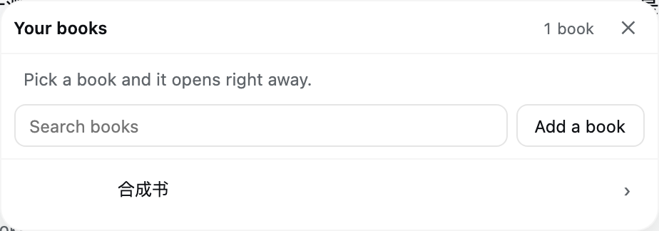
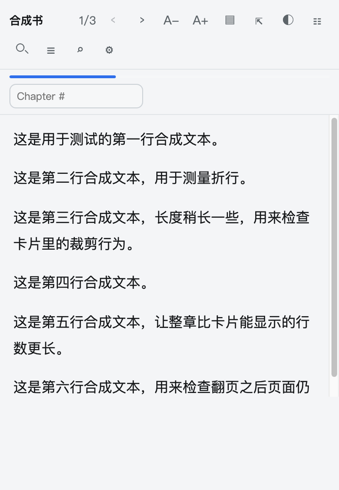
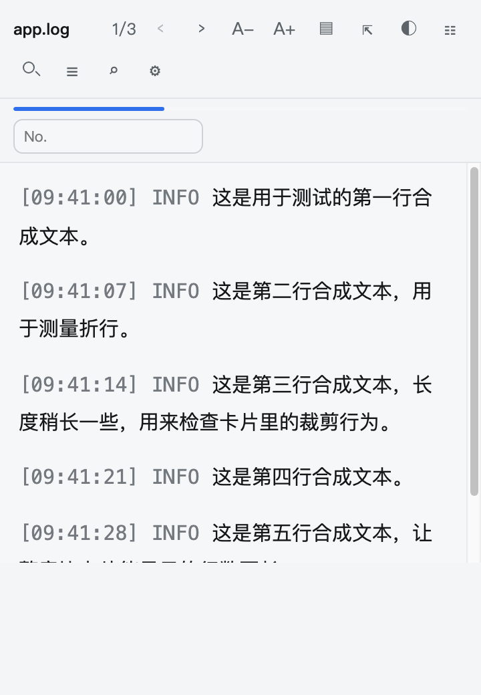
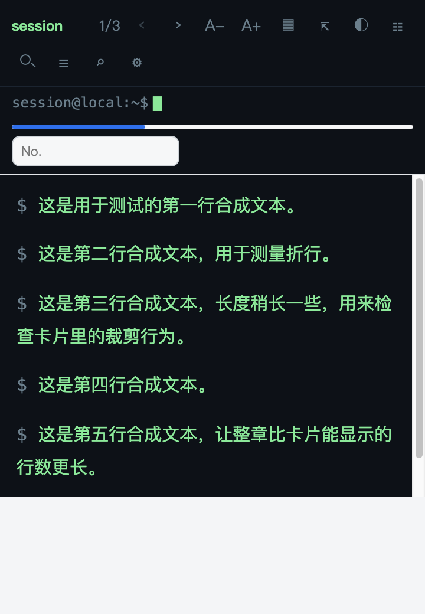
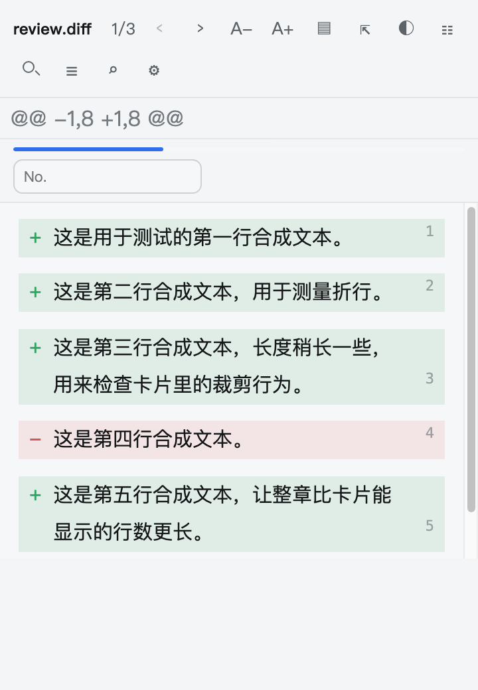
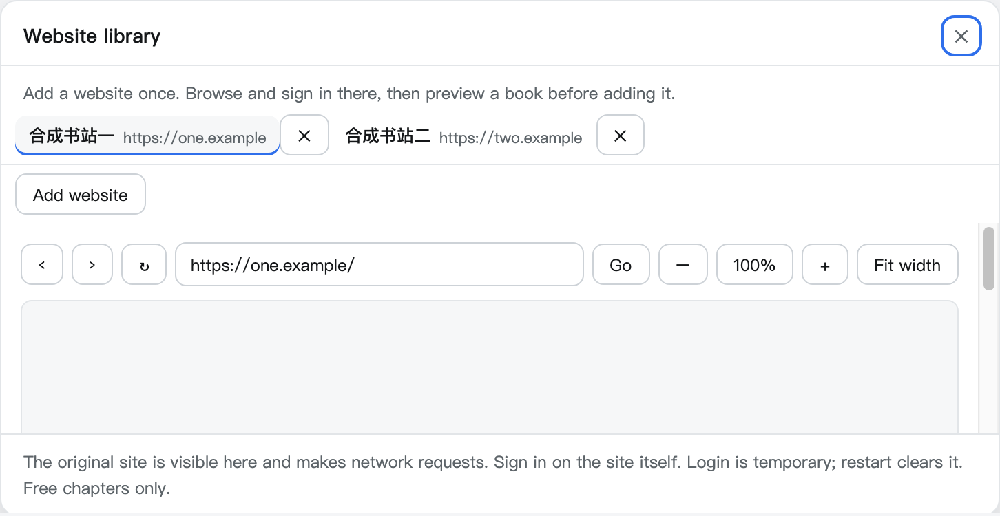

# 隐蔽阅读器

一个住在 DeepSeek Harness 窗口里的小说阅读器。它读本地文件和网络小说，并且不让
小说内容进入你的对话。它出现在哪由你决定：右侧一栏，或者输入框上方一行不起眼的
文字。

[English](README.md) | 中文

卡片在桌面版里、输入框上方的真实样子。图中章节正文和书名已遮罩：它展示的是阅读器
本身的形状，不是读的是什么。


折叠起来，同一张卡片就是输入区里一行安静的横条。这一张用的是封面故事：读起来像一条
同步摘要，不像一本书。


不遮罩的样子，用合成文字，两种主题：




## 安装

用哪种方式取决于你的 Harness 是怎么跑的。

**在 DeepSeek Harness 桌面版里。** 打开 **插件**，选 **添加插件**，粘贴包名：

```
dsh-plugin-stealth-reader
```

**在终端里，针对普通 `dsh web`。**

```sh
dsh plugin --profile web add dsh-plugin-stealth-reader
```

然后重启 `dsh web`。自定义 profile 就把 `web` 换成它的名字。
**不要用这个给桌面版装**：桌面版管理自己的 profile，终端装进去的是另一个，插件
不会出现在桌面版里。请用应用内的 **插件 → 添加插件**。

**从本地仓库安装**，想改插件本身时用：

```sh
dsh plugin --profile web add /指向/dsh-plugin-stealth-reader 的绝对路径
```

插件启用之后，**刷新 Harness 窗口（⌘R）**。面板是客户端代码，已经开着的窗口会继续
跑它启动时的那一份。

要卸载，在 **插件** 页禁用或移除这个 bundle。已缓存的章节留在磁盘上；想删掉就删
profile 下的阅读器目录。

## 自己验证

这个仓库里的检查都是对着**正在发布的**插件跑的，只用合成书籍——不碰真实书库，也
不联网。

```sh
node stealth-reader-selftest.mjs      # 宿主行为
node stealth-reader-webtest.mjs       # 网页读取与解析
node stealth-reader-routetest.mjs     # 本地路由与隐私承诺
node stealth-reader-storetest.mjs     # 存储、缓存与凭据规则
node stealth-reader-crashprobe.mjs    # 阅读器的组件
node stealth-reader-browsertest.mjs   # 隔离的站点浏览器
node verify/dom/run-dom-test.mjs      # 真实 Chrome 里加载发布的客户端
bash deploy-gate.sh                   # 发布所坚持的每一项
```

`run-dom-test.mjs` 需要本机装有 Chrome。`--shot=<路径>` 拍卡片，`--dark` 走深色，
`--zh` 走中文，`--empty` 模拟新装，`--sites` 打开找书页。

## 更新之后

面板是客户端代码，所以 Harness 窗口必须重新加载新版本。插件启用或更新后刷新窗口
（⌘R），否则面板会一直跑它启动时的那份代码。

## 它出现在哪

打开设置（工具栏的 **⚙**），二选一。选择会被记住，下次回来还在原处。

| 位置 | 你看到的 |
| --- | --- |
| **侧栏** | 阅读面板作为右侧栏的一个标签页打开 |
| **输入框上方** | 输入框上方有一个很小、很淡的记号，正文以一两行的形式出现在它上面 |

### 侧栏

阅读器是右侧栏的一个标签页，和终端、其他 Harness 面板并排。按 **Ctrl+Alt+N**
打开；侧栏自己的关闭按钮把它收起来。面板填满整个标签页，所以它没有自己的边框和
关闭按钮——那是侧栏管的。开别的标签页不会关掉阅读器：它会留在侧栏，直到你关掉它
或把它移回卡片。

### 输入框上方

输入框上面、DeepSeek 标志下面有一个很小的记号，刻意做得低对比度，不抢眼睛。

- 鼠标移上去（或按 Tab 到它），输入框上方会出现一两行正文。
- **滚轮就是翻页。** 在条上滚动，一次走一行，滚到章末自动进下一章。
- 翻到书的开头或结尾，滚轮就还给对话。

## 你看到的

面板是一个独立表面，和对话分开。章节正文永远不会写进会话，所以聊天记录、会话标题
和侧栏摘要里都不会出现它。

## 设置

设置是 Harness 设置里的一页，所以改偏好不用绕道阅读界面。选一次，处处生效：面板、
侧栏和卡片读的是同一份设置。

- **阅读**——字号、行距、字体、栏宽、一章读完是否自动连读、卡片每页显示几行
  （默认 3 行）。
- **位置**——侧栏还是输入框上方。
- **外观**——皮肤、卡片首行说什么（书名 / 进度 / 不显示名字）、收起后的小条中间
  说什么、小条显示多少进度（百分比 / 进度条 / 两者 / 都不显示）、自动收起的延迟、
  收起方式、收起后是小圆点还是一行小条。
- **书库**——本地文件、网页小说、记住的目录、书库画成列表还是书架。
- **网站**——添加过的站点。

## 阅读功能

- 整章按卡片自己的宽度重排，所以正文填满卡片，而不是每行末尾留一段空白。
- 页面结束在一整行上，绝不切断一个字。收起再展开也一样——指针移开又回来，看到的
  还是同一页。
- 搜索整本书，按顺序走过每一个找到的位置。
- 目录列出每一章，一点就到。
- 阅读位置按书记住，换皮肤、换位置都不丢。

## 快捷键

| 快捷键 | 作用 |
| --- | --- |
| `Ctrl+Alt+N` | 显示或隐藏面板 |
| `Ctrl+Alt+→` | 下一章 |
| `Ctrl+Alt+←` | 上一章 |
| `Ctrl+Alt+D` | 切换下一个伪装皮肤 |
| `Ctrl+Alt+=` / `Ctrl+Alt+-` | 放大 / 缩小字号 |

桌面版上这些组合键是通过 Harness 快捷键服务预留的，所以它们会出现在快捷键列表里，
也不会和别的命令冲突。除了 `Ctrl+Alt+N`，每个组合键都作用在面板上，所以只在面板
打开时生效：藏起来的面板绝不会在背后翻页。

macOS 上是 `Control+Option`（`⌃⌥`），不是 `Command`。macOS 的系统快捷键都是
`Command` 系的，所以互不干扰。

面板之外的输入框获得焦点时，组合键会被忽略，所以在聊天框或设置里打字永远不会被
打断。面板内部组合键照常工作，所以搜索框有焦点时方向键仍然能翻页。

## 支持的格式

`.txt`、`.epub`、`.docx`、`.md`、`.html`，以及网页小说。GBK 和 UTF-8 都能读。

## 阅读位置

每本书单独记住：读到哪里、用什么放大比例、在哪种模式里读的。换皮肤、换位置、关掉
窗口都不会丢。

## 伪装皮肤

`plain` 皮肤显示书名；其他三个不显示。它们把文档编号，并且把每一行装扮成别的
东西——一份日志、一个终端、一次代码审查。









当「你在读什么」本身就是需要藏起来的东西时，选一个。

## 添加书



- **本地文件**——单独添加一个，或者整目录导入。
- **记住的目录**——可以重新扫描，把后来新增的文件加进来。
- **网页小说**——粘贴目录页地址，指定章节链接和正文的 CSS 选择器。
- **网站**——添加一次站点，之后在应用内浏览、登录、识别当前这本书。

什么都不上传。书库、阅读位置和缓存都留在这台机器上。

## agent 工具

插件注册一个叫 `doc_panel` 的工具，让 agent 管理书库。它只报告数量和位置，永远
不报告书名、路径或正文——除非你显式要求 `reveal: true`。这是刻意的：工具返回值会
进入会话记录，而这个插件的全部意义就是不让小说进去。

发布关卡会拒绝任何可能把章节正文放进工具返回值的构建。

## 数据与网络

- 书库、阅读位置、设置和缓存都在本机，不上传。
- 已取回的网页章节缓存在磁盘上，重读不发网络请求。
- 网站登录态只留在那个隔离的临时会话里，应用重启即清空。密码和 Cookie 不会被
  复制到任何地方。
- 只导入免费可读的章节。

## 限制

- 完全由客户端脚本生成的目录页拿不到章节链接；换一个链接就在返回 HTML 里的页面。
- **找书**需要桌面窗口。屏蔽内嵌浏览器的站点，或者需要原生弹窗、硬件密钥的登录，
  在隔离的客体里可能用不了；插件会如实报错，而不是绕过它去抓。
- 「适应宽度」只针对宽度，不是把长页面整段缩进一屏；缩放下限 40%，不从已有比例
  放大。

## 许可

MIT。
